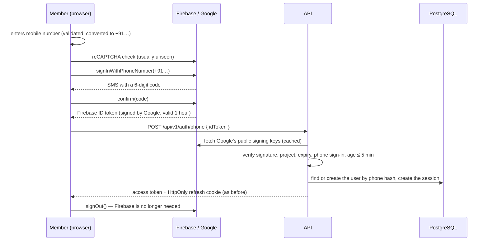

# Member sign-in: Firebase Phone Authentication

> Related: [Authentication](authentication.md), [Sign-in flow](otp-flow.md), [Session management](session-management.md), [Environment variables](../setup/environment-variables.md), [Meta WhatsApp (notifications)](../notifications/meta-whatsapp.md)

## Status

| | |
|---|---|
| Code | Complete: web flow, API token verification, tests |
| Automated tests | Pass. They use a stand-in for Firebase: **no test contacts Firebase or sends an SMS** |
| Real SMS sign-in | **Not verified.** It needs the Firebase console steps in §5 and the first-login check in §9, which only the project owner can do |

Do not treat production sign-in as working until §9 has been done on the live site.

## 1. Purpose

Members sign in with their mobile number and a 6-digit code. Firebase Phone Authentication sends that code **by SMS** and checks it. It replaces the earlier flow, in which the API generated the code and sent it on WhatsApp.

What changed and what did not:

| | Before | Now |
|---|---|---|
| Who sends the code | Our API, through the Meta WhatsApp Cloud API | Firebase, by SMS |
| Who checks the code | Our API (`otp_requests` table) | Firebase |
| Bot protection | Rate limits | Google reCAPTCHA (run by Firebase) + rate limits |
| Accounts, sessions, roles, refresh cookie, logout | Our API | **Unchanged**: our API |
| WhatsApp notifications, templates, delivery webhook | Meta | **Unchanged**: Meta ([guide](../notifications/meta-whatsapp.md)) |

Firebase is used for one thing: proving that the person holds the phone number. It is not the session. After the proof, our API issues the same access token and `gp_rt` refresh cookie as before.

## 2. How it works



The API never receives the phone number or a "verified" flag from the browser. It reads the number from inside the token, after checking that Google signed the token for our project.

### Code map

| Concern | File |
|---|---|
| Token verification | `apps/api/src/providers/firebase/phone-token.verifier.ts` |
| Sign-in service (find or create the user, session) | `apps/api/src/modules/auth/auth.service.ts` (`loginWithPhoneToken`) |
| Route, controller, rate limit | `apps/api/src/modules/auth/auth.{routes,controller}.ts`, `apps/api/src/middlewares/rate-limit.ts` |
| Request schema, limits, error code | `packages/shared/src/{schemas/auth.schema,constants/limits,errors/error-codes}.ts` |
| Firebase initialisation (web) | `apps/web/src/lib/firebase.ts` |
| Sign-in flow, error messages (no Firebase imports) | `apps/web/src/features/auth/phone-sign-in.ts` |
| Firebase SDK calls, reCAPTCHA | `apps/web/src/features/auth/firebase-phone-sdk.ts` |
| Screens | `apps/web/src/pages/{LoginPage,VerifyOtpPage}.tsx` |
| Content-Security-Policy for Google's hosts | `deploy/nginx/snippets/gp-web-headers.conf.template` |

## 3. API

### `POST /api/v1/auth/phone`

Exchanges a Firebase ID token for a session. Public (it is how members sign in), rate-limited to **30 requests per IP per 15 minutes**. The same endpoint signs up new members and logs in existing ones.

Request:

```json
{ "idToken": "<Firebase ID token>" }
```

The body may contain **only** `idToken`. Any other field (`phone`, `uid`, `role`, `isAdmin`, `phoneVerified`, …) is rejected with `400 VALIDATION_ERROR`.

**200 OK** (same shape as the old `verify-otp`), plus the `gp_rt` cookie (`HttpOnly`, `SameSite=Strict`, `Path=/api/v1/auth`):

```json
{
  "success": true,
  "message": "Success",
  "data": {
    "accessToken": "<JWT, 15 minutes>",
    "accessTokenExpiresAt": "2026-10-12T10:15:00.000Z",
    "user": { "id": "…", "status": "active", "onboardingStatus": "incomplete", "photoVerified": false }
  }
}
```

Errors:

| Status | Code | When |
|---|---|---|
| 400 | `VALIDATION_ERROR` | `idToken` missing or not a plausible token; extra fields in the body |
| 401 | `PHONE_VERIFICATION_FAILED` | The token could not be verified (see §4). Message: "We could not verify your phone number. Please request a new code." The response never says which check failed |
| 401 | `PHONE_VERIFICATION_FAILED` | The verified number is not an Indian mobile number. Message: "Only Indian mobile numbers are supported." |
| 403 | `ACCOUNT_BANNED` | The number belongs to a banned account. No session is created |
| 429 | `RATE_LIMITED` | Too many attempts from this address |
| 503 | `SERVICE_UNAVAILABLE` | Google's signing keys could not be fetched. Nobody is signed in on a guess |

Removed: `POST /auth/send-otp` and `POST /auth/verify-otp` now return `404`. Unchanged: `POST /auth/refresh`, `POST /auth/logout`, `GET /auth/me`.

## 4. What the API checks

A token is accepted only if **all** of these hold. Each rejection is covered by a test.

| Check | Protects against |
|---|---|
| Signed with RS256 by one of Google's current keys | Forged or tampered tokens; unsigned tokens; HS256 "downgrade" tokens |
| `iss` is `https://securetoken.google.com/<FIREBASE_PROJECT_ID>` and `aud` is `<FIREBASE_PROJECT_ID>` | A valid token from someone else's Firebase project |
| Not expired | Old tokens |
| `firebase.sign_in_provider` is `phone` | A token from another sign-in method that happens to carry a number |
| `phone_number` is present and is an Indian mobile number | Tokens without a verified number; unsupported countries |
| `auth_time` is at most 5 minutes ago (`LIMITS.PHONE_TOKEN_MAX_AGE_SECONDS`) | Replaying a captured token later (a Firebase token itself lives for an hour) |
| `sub` (the Firebase user ID) is present | Malformed tokens |

Accounts are matched by **phone number** (`users.phone_hash`), exactly as before. The Firebase user ID is not stored and does not identify the account, so:

- every member who signed up with a WhatsApp code keeps the same account;
- a different Firebase user ID for the same number is still the same account;
- no database change was needed.

Two first-time sign-ins for one number at the same moment create one account (a per-number lock inside the transaction, plus the unique index on `phone_hash`).

No Firebase Admin SDK and **no service-account key** is used. The API only needs Google's *public* keys, fetched over HTTPS from `https://www.googleapis.com/service_accounts/v1/jwk/securetoken@system.gserviceaccount.com` and cached. The server must be able to make outbound HTTPS requests to `www.googleapis.com`.

## 5. Firebase console setup

Do these once, in the [Firebase console](https://console.firebase.google.com/), in the project whose ID you put in `FIREBASE_PROJECT_ID`. Menu names can change slightly over time.

1. **Enable phone sign-in.** Build → Authentication → Sign-in method → Phone → Enable → Save.
2. **Billing.** Sending real SMS is a paid Firebase feature. Upgrade the project to the Blaze (pay-as-you-go) plan and set a budget alert. Check the current SMS prices and any free allowance in the console: they are set by Google and are not recorded here.
3. **Authorized domains.** Authentication → Settings → Authorized domains. Add the domain members use (`garbamates.in`, and `www.garbamates.in` if it serves the app). `localhost` is there by default and is needed for local development. Sign-in from any domain not on this list fails with code `unauthorized-domain`.
4. **SMS region policy.** Authentication → Settings → SMS region policy → *Allow* → select **India** only. This stops SMS being sent (and billed) to other countries.
5. **Test phone numbers (for local development and QA).** Authentication → Sign-in method → Phone → *Phone numbers for testing*. Add a number and a fixed code of your choice. Signing in with a test number sends no SMS, costs nothing and does not count against quotas. Use numbers that nobody owns.
6. **Web configuration.** Project settings (gear icon) → General → Your apps → your Web app → SDK setup and configuration → *Config*. Copy `apiKey`, `authDomain`, `projectId` and `appId` into the `VITE_FIREBASE_*` variables (§6). You do not need `measurementId`, `storageBucket` or `messagingSenderId`.
7. **Do not create a service-account key.** Nothing in this project uses one. If one was downloaded, delete the file and revoke the key (Project settings → Service accounts → Manage service account permissions).

Optional hardening, after sign-in works:

- **Restrict the web API key.** Google Cloud console → APIs & Services → Credentials → the browser key. Under *Website restrictions* list your domains (`https://garbamates.in/*`, `https://garbamates.firebaseapp.com/*`, `http://localhost:*` for development). A wrong restriction breaks sign-in for everyone, so test straight after changing it.
- **Quotas and abuse.** Authentication → Settings → review the sign-up quota per IP address, and consider Firebase's SMS fraud-protection options.

reCAPTCHA needs no setup: Firebase provides it. It must stay on. The code never sets `appVerificationDisabledForTesting`.

## 6. Environment variables

| Variable | Where | Secret? | Value |
|---|---|---|---|
| `FIREBASE_PROJECT_ID` | API (required; the API does not start without it) | No | The project ID, e.g. `garbamates` |
| `VITE_FIREBASE_API_KEY` | Web build | No | `apiKey` from the web config |
| `VITE_FIREBASE_AUTH_DOMAIN` | Web build | No | `authDomain`, e.g. `garbamates.firebaseapp.com` |
| `VITE_FIREBASE_PROJECT_ID` | Web build | No | `projectId`; must equal `FIREBASE_PROJECT_ID` |
| `VITE_FIREBASE_APP_ID` | Web build | No | `appId` |

The Firebase web configuration is public by design: it identifies the project and is visible in every visitor's browser. It is not a credential. What protects the project is the authorized-domains list, the SMS region policy, reCAPTCHA and our server-side token check.

`VITE_*` values are baked into the web bundle **when it is built**. After changing them, rebuild the web app.

Removed variables (delete them from old env files; they are ignored if left): `OTP_PROVIDER`, `LOG_OTP`, `META_WHATSAPP_OTP_TEMPLATE`. `OTP_HMAC_SECRET` **stays**: it also keys the IP hashes in session and audit records.

If the `VITE_FIREBASE_*` variables are missing, the site still loads; the login page says sign-in is not set up and the Send button is disabled.

## 7. Local development

1. Put the five variables in the root `.env`.
2. Add a test phone number in the Firebase console (§5, step 5).
3. `npm run dev`, open the web app, enter the test number, then the fixed code you chose.

A real number also works locally, but it sends a real, billed SMS. There is no on-screen development code any more and no way to skip the code: the API always verifies a real Firebase token.

## 8. Deploying

No database migration is needed.

1. Complete §5 in the Firebase console.
2. Add the five variables to the production env file (`deploy/env/production.env.example` shows where). Remove `OTP_PROVIDER`, `LOG_OTP` and `META_WHATSAPP_OTP_TEMPLATE`.
3. Run `deploy/scripts/preflight.sh`. It checks that the Firebase variables are set, that both project IDs match, and that the env file contains no private key.
4. Build and deploy as usual (the web app must be **rebuilt** so it contains the Firebase configuration).
5. Re-render the Nginx configuration and reload (`deploy/scripts/render-nginx.sh`). The web Content-Security-Policy now allows Google's reCAPTCHA and Firebase's auth endpoints. **Without this step the browser blocks the security check and nobody can request a code.**
6. Restart the API.
7. Do the first-login check (§9).

The Content-Security-Policy additions:

| Directive | Added | Why |
|---|---|---|
| `script-src` | `https://www.google.com/recaptcha/` `https://www.gstatic.com/recaptcha/` | reCAPTCHA script |
| `frame-src` | `https://www.google.com/recaptcha/` `https://recaptcha.google.com/recaptcha/` | reCAPTCHA challenge |
| `connect-src` | `https://identitytoolkit.googleapis.com` `https://securetoken.googleapis.com` `https://www.google.com/recaptcha/` | Firebase Auth requests |

## 9. First-login check (manual, on the live site)

- [ ] Open the site in a private window. The login page shows no "not set up" warning.
- [ ] The browser console shows no Content-Security-Policy errors on the login page.
- [ ] Enter a real Indian mobile number. An SMS with a 6-digit code arrives.
- [ ] Enter the code. You are signed in.
- [ ] Reload the page. You are still signed in.
- [ ] Log out, then sign in with a number that already had an account before the change. It opens the **same** account (same profile).
- [ ] Enter a wrong code: "That code is not correct." Wait for the countdown, press Resend: a new SMS arrives and works.
- [ ] Try the site on a phone (Android Chrome and iPhone Safari).
- [ ] With WhatsApp notifications on: trigger a notification and confirm it still arrives (they are independent of sign-in).

## 10. Security considerations

- **Nothing from the browser is trusted** except a Google-signed token for our project (§4).
- **No secrets in the browser.** The web bundle contains only the public Firebase configuration. No service-account key exists anywhere in the project.
- **Tokens are not stored in the browser.** Firebase runs with in-memory persistence, so it writes no token to localStorage or IndexedDB, and the app signs out of Firebase straight after the exchange. Our access token stays in memory; the refresh token stays in the HttpOnly cookie.
- **Nothing sensitive is logged.** A refused token is logged with a reason only (`bad_signature`, `expired`, `wrong_project`, `too_old`, …). The token, the phone number and our own tokens never reach the log or the `api_logs` table. The API never sees a login code at all.
- **Members see plain messages.** Firebase's error objects stay inside `phone-sign-in.ts`. Set-up problems show a short reference such as `(Code: unauthorized-domain)` so support can identify the cause (§11).
- **Rate limits.** 30 exchanges per IP per 15 minutes on our endpoint; Firebase applies its own limits per number, per IP and per project, and reCAPTCHA screens out automated requests.
- **Analytics is not initialised.** Only Firebase Auth is loaded, and only when the login page opens.
- **Third parties.** Google now processes members' phone numbers for sign-in, and reCAPTCHA collects device and browser signals. The privacy policy and terms were updated to say so ([privacy](../../apps/web/src/features/legal/content.ts)); have them reviewed before launch.
- **Bans and suspensions** are enforced by our API after the token check, as before.

## 11. Troubleshooting

| What the member sees | Likely cause | Fix |
|---|---|---|
| "Sign-in is not set up on this site yet." | `VITE_FIREBASE_*` missing when the web app was built | Set them and rebuild the web app |
| "…unavailable right now. (Code: unauthorized-domain)" | The site's domain is not in Authorized domains | §5 step 3 |
| "… (Code: operation-not-allowed)" | Phone sign-in is not enabled, or the number's country is blocked by the SMS region policy | §5 steps 1 and 4 |
| "… (Code: billing-not-enabled)" or "(Code: quota-exceeded)" | No billing on the project, or the SMS quota is used up | §5 step 2; check quotas in the console |
| "… (Code: invalid-api-key)" | Wrong `VITE_FIREBASE_API_KEY`, or the key's restrictions exclude this site | Fix the value or the key restriction; rebuild |
| "The security check did not complete." | reCAPTCHA could not load or run: the Content-Security-Policy was not updated, a content blocker, or no connection | §8 step 5; ask the member to disable the blocker |
| "Too many attempts. Please wait a while." | Firebase's limit for that number or device | Wait; nothing to change |
| "That code is not correct." / "This code has expired." | Wrong or old code | Resend |
| "We could not verify your phone number." (after entering a correct code) | The API refused the token. Check the API log line `Phone sign-in token rejected` for the `reason` | `wrong_project`: `FIREBASE_PROJECT_ID` differs from `VITE_FIREBASE_PROJECT_ID`. `too_old`: more than 5 minutes passed, or the server clock is wrong. `expired`: server clock |
| "We could not verify your number right now." (503) | The server cannot reach `www.googleapis.com` | Allow outbound HTTPS from the server |
| No SMS arrives, no error | Carrier delay or filtering | Try Resend; check Authentication → Usage in the console |

## 12. Edge cases

| Case | Behaviour |
|---|---|
| Page reloaded on the code screen | The pending code lives in memory only: the member is sent back to the phone screen |
| Double tap on Send | One code is sent |
| Resend | Available after 30 seconds; reuses the existing reCAPTCHA. Only the newest code works |
| reCAPTCHA expires, fails or is dismissed | It is removed and a fresh one is created on the next attempt. A challenge that is never answered stops waiting after 2 minutes |
| Firebase accepts the code but our API call fails (network) | Pressing Verify again re-sends the same proof without re-confirming the code. After 5 minutes a new code is needed |
| "Change number" | The pending code is forgotten and the reCAPTCHA removed |
| Number not on WhatsApp | Irrelevant now: the code comes by SMS |
| Non-Indian number | Refused on the page; refused again by the API if a token for one ever arrives |

## 13. Testing

| Test file | Covers |
|---|---|
| `apps/api/src/providers/firebase/phone-token.verifier.test.ts` | Every check in §4, with tokens signed by a local key pair standing in for Google |
| `apps/api/src/modules/auth/auth.int.test.ts` | `POST /auth/phone`: new member, existing member keeps the account, concurrent first sign-ins, forged / expired / wrong-project / no-phone / replayed tokens, non-Indian number, extra body fields rejected (no role escalation), banned account, keys unavailable (503), rate limit, old endpoints gone; plus logout and refresh |
| `apps/api/src/middlewares/api-logging.int.test.ts` | Tokens and numbers never appear in logs or `api_logs` |
| `apps/api/src/security/{security.int,env-rules}.test.ts` | Rate limiting, CSRF on refresh, `FIREBASE_PROJECT_ID` required |
| `apps/api/src/modules/whatsapp/whatsapp-webhook.int.test.ts`, `apps/api/src/providers/meta/whatsapp.client.test.ts` | WhatsApp notifications and the delivery webhook still work without the login-code path |
| `apps/web/src/features/auth/phone-sign-in.test.ts` | The browser flow against a fake SDK: send, resend with one reCAPTCHA, wrong and expired codes, reCAPTCHA failure / expiry / timeout and retry, reset, error-message mapping |

Run them with `npm run test` (integration tests need `TEST_DATABASE_URL`). Firebase and Meta are replaced by stand-ins in every automated test.

## 14. Database

No schema change. The `otp_requests` table is **no longer written or read**. It was left in place deliberately (no data was deleted); it can be dropped by a later migration once the change has settled.

## 15. Known limitations

- Real SMS delivery, the live reCAPTCHA and the production Content-Security-Policy have not been exercised. §9 is the test.
- SMS costs money per message and depends on Indian carrier delivery (including DLT filtering on Firebase's side). There is no fallback channel if an SMS does not arrive.
- Only Indian (+91) mobile numbers can sign in.
- The API's own rate limit is in memory (resets on restart, not shared between processes), like the other IP limiters.
- Firebase's app library keeps a small "heartbeat" record in IndexedDB (dates only, no account data). No auth token is stored.
